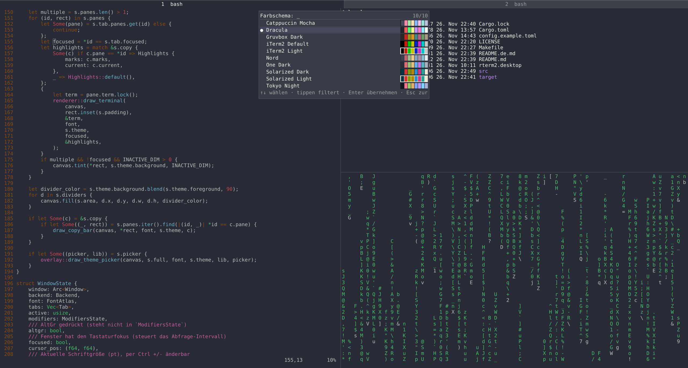

# rterm2

[English](README.md) · **Deutsch**

Terminal-Emulator für Linux (X11 und Wayland) in Rust, inspiriert von iTerm2: Tabs, Split Panes, iTerm2-Farbschemas und GPU-Rendering – komplett per Tastatur bedienbar. Den Terminal-Kern (VT100/xterm) liefert [`alacritty_terminal`](https://github.com/alacritty/alacritty).



## Funktionen

- **Fenster, Tabs und Split Panes** per Tastenkürzel, angelehnt an iTerm2
- **Pane-Wechsel per Tastatur** (Ctrl+Shift+H/J/K/L), Pane maximieren, Trennlinien verschieben
- **Farbschemas:** 10 eingebaute, beliebige `.itermcolors`-Dateien, Auswahl mit Live-Vorschau (Ctrl+Shift+P)
- **GPU-Rendering** mit wgpu (Vulkan, sonst OpenGL), CPU als Rückfall
- **Suche im Verlauf** und **Copy-Mode** (vim-artig) – Text markieren und kopieren ohne Maus
- **Eigene Tastenkürzel** in der `config.toml`
- **Tab-Titel** zeigen das laufende Programm der aktiven Pane (`zsh`, `nvim`, `htop` …)
- Maus optional: markieren, PRIMARY-Auswahl, Mausmodus für mc/htop/vim, Trennlinien ziehen

## Debian-Paket

Fertige Pakete für **amd64** und **arm64** gibt es unter [Releases](../../releases) (gebaut auf Debian 12, laufen auch auf Debian 13 und aktuellen Ubuntu-Versionen):

```sh
sudo apt install ./rterm2_*_amd64.deb      # arm64: ./rterm2_*_arm64.deb
```

Selbst bauen: `cargo install cargo-deb`, dann `make deb` → `target/debian/`.

## Bauen & installieren mit make

```sh
make              # Release-Build
make install      # nach ~/.local/bin + Startmenü-Eintrag (systemweit: sudo make install PREFIX=/usr/local)
make config       # Config-Vorlage nach ~/.config/rterm2/config.toml (überschreibt nichts)
make uninstall    # wieder entfernen, die eigene Config bleibt
make help         # alle Ziele: run, test, check, fmt, clippy, deb, clean …
```

`~/.local/bin` muss in `PATH` stehen, damit das Startmenü rterm2 findet – `make install` weist darauf hin. Für Pakete: `make install DESTDIR=/tmp/pkg PREFIX=/usr`.

## Bauen & starten mit cargo

```sh
cargo run --release
RUST_LOG=info cargo run           # mit Log-Ausgabe
RUST_LOG=rterm2=debug cargo run   # zeigt jede Taste samt Modifikatoren
```

Benötigt: aktuelles Rust (stable, über [rustup](https://rustup.rs)), `fc-match` (fontconfig) zum Finden der Schrift, alternativ `[font] path` setzen.

Ohne make installieren:

```sh
cargo install --path .                                                     # Programm nach ~/.cargo/bin/rterm2
install -Dm644 rterm2.desktop ~/.local/share/applications/rterm2.desktop   # Eintrag im Startmenü
```

## Konfiguration

Eine vollständige Vorlage mit allen Einstellungen und ihren Standardwerten liegt in `config.example.toml`:

```sh
mkdir -p ~/.config/rterm2 && cp config.example.toml ~/.config/rterm2/config.toml
```

Kurzfassung von `~/.config/rterm2/config.toml`:

```toml
theme = "Dracula"   # Name (eingebaut oder aus ~/.config/rterm2/themes/) oder Pfad zu einer .itermcolors-Datei
shell = "/usr/bin/zsh -l"
padding = 6
renderer = "auto"   # "auto" (GPU, sonst CPU), "gpu" oder "cpu"

[font]
path = "/usr/share/fonts/TTF/JetBrainsMono-Regular.ttf"
size = 14.0
```

## Tastenkürzel

| Aktion | rterm2 | iTerm2 |
|---|---|---|
| Neues Fenster | Ctrl+Shift+N | ⌘N |
| Neuer Tab | Ctrl+Shift+T | ⌘T |
| Nächster / vorheriger Tab | Ctrl+PageDown / Ctrl+PageUp, Ctrl+Tab / Ctrl+Shift+Tab | ⌘⇧] / ⌘⇧[ |
| Tab 1–9 wählen | Alt+1 … Alt+9 oder Klick auf den Tab | ⌘1 … ⌘9 |
| Tab schließen | Mittelklick auf den Tab | |
| Vertikal teilen (neue Pane rechts) | Ctrl+Shift+D | ⌘D |
| Horizontal teilen (neue Pane unten) | Ctrl+Shift+E | ⇧⌘D |
| Pane schließen (letzte Pane schließt Tab bzw. Fenster) | Ctrl+Shift+W | ⌘W |
| Pane wechseln | Ctrl+Shift+H/J/K/L (links/unten/oben/rechts), Alt+Pfeiltasten, Ctrl+Alt+Pfeiltasten (auch mit AltGr) oder Klick | ⌥⌘ Pfeile |
| Trennlinie verschieben | Ctrl+Shift+Pfeiltasten | ⌃⌘ Pfeile |
| Pane maximieren / zurück | Ctrl+Shift+Enter | ⇧⌘↩ |
| Zurückscrollen | Shift+PageUp/PageDown, Mausrad | |
| Kopieren / Einfügen | Ctrl+Shift+C / Ctrl+Shift+V | ⌘C / ⌘V |
| Farbschema wählen | Ctrl+Shift+P | |
| Im Verlauf suchen | Ctrl+Shift+F | ⌘F |
| Copy-Mode | Ctrl+Shift+Space | ⇧⌘C |
| Schrift größer / kleiner / zurücksetzen | Ctrl++ (bzw. Ctrl+=) / Ctrl+- / Ctrl+0 | ⌘+ / ⌘- / ⌘0 |

## Suchen und Kopieren per Tastatur (Copy-Mode)

**Ctrl+Shift+F** sucht im Verlauf (nach oben), **Ctrl+Shift+Space** startet den Copy-Mode ohne Suche. Unten in der Pane erscheint eine Statuszeile.

| Taste | Wirkung |
|---|---|
| h j k l / Pfeiltasten | Cursor bewegen |
| w b e (W B E) | Wort vor / zurück / Wortende (ganze WÖRTER) |
| 0 ^ $ | Zeilenanfang / erstes Zeichen / Zeilenende |
| gg / G | ganz nach oben / unten |
| H M L | oben / Mitte / unten im sichtbaren Bereich |
| Ctrl+U / Ctrl+D, Ctrl+B / Ctrl+F, PageUp / PageDown | halbe / ganze Seite |
| { } / % | Absatz hoch / runter, passende Klammer |
| v / V / Ctrl+V | Markieren: Zeichen / Zeilen / Block (nochmal = aufheben) |
| y oder Enter | Markierung kopieren (Zwischenablage + PRIMARY) und beenden |
| / bzw. ? | suchen nach unten bzw. oben – wörtlich; nur Kleinbuchstaben = Groß/Klein egal |
| Enter / Esc (in der Suche) | Treffer übernehmen / zurück zur Startposition |
| n / N | nächster / vorheriger Treffer |
| Esc | Markierung aufheben, beim zweiten Mal beenden (auch q, Ctrl+C) |

Alle Treffer im sichtbaren Bereich sind gelb, der aktuelle orange hinterlegt. Ein Mausklick beendet den Copy-Mode.

## Eigene Tastenkürzel

In `config.toml` ersetzt ein Eintrag unter `[keybindings]` **alle** Standard-Kürzel der Aktion. Soll ein Standard-Kürzel bleiben, muss es mit in der Liste stehen:

```toml
[keybindings]
split_right = ["ctrl+shift+d", "super+d"]     # Standard behalten + zusätzliches Kürzel
focus_left  = ["ctrl+shift+h", "alt+left"]    # mehrere Kürzel
close_pane  = "none"                          # Aktion abschalten
```

Modifikatoren: `ctrl`, `shift`, `alt`, `altgr`, `super`. Tasten: Buchstaben/Ziffern/Zeichen, `plus`, `minus`, `equal`, `enter`, `tab`, `space`, `escape`, `backspace`, `delete`, `insert`, `home`, `end`, `pageup`, `pagedown`, `left`, `right`, `up`, `down`, `f1`–`f12`. Ist ein Kürzel schon einer anderen Aktion zugeordnet, gewinnt der Config-Eintrag. Fehler (unbekannte Aktion/Taste) werden beim Start gemeldet.

Aktionen: `new_window`, `new_tab`, `next_tab`, `prev_tab`, `select_tab_1` … `select_tab_9`, `split_right`, `split_down`, `close_pane`, `toggle_zoom`, `focus_left/right/up/down`, `resize_left/right/up/down`, `scroll_page_up`, `scroll_page_down`, `copy`, `paste`, `font_bigger`, `font_smaller`, `font_reset`, `theme_picker`, `search`, `copy_mode`.

Welche Taste rterm2 wie sieht: `RUST_LOG=rterm2=debug rterm2`.

## Farbschemas

**Ctrl+Shift+P** öffnet die Schema-Auswahl – komplett per Tastatur:

- ↑/↓ (oder Ctrl+J/K, Ctrl+N/P), PageUp/PageDown, Home/End: wählen – das Schema wird **sofort live** angezeigt
- tippen: filtern (unscharf, „tn“ findet „Tokyo Night“), Backspace löscht
- **Enter** übernimmt und speichert `theme = "…"` in der `config.toml` (Kommentare und Rest bleiben erhalten)
- **Esc** kehrt zum vorherigen Schema zurück

Eingebaut: iTerm2 Default, iTerm2 Light, Solarized Dark/Light, Dracula, Gruvbox Dark, Nord, One Dark, Tokyo Night, Catppuccin Mocha.

Eigene Schemas: jede `.itermcolors`-Datei in `~/.config/rterm2/themes/` erscheint unter ihrem Dateinamen in der Liste (gleicher Name ersetzt ein eingebautes Schema). Über 450 fertige Schemas gibt es unter https://iterm2colorschemes.com (Ordner `schemes/`):

```sh
mkdir -p ~/.config/rterm2/themes
git clone --depth 1 https://github.com/mbadolato/iTerm2-Color-Schemes /tmp/itcs
cp /tmp/itcs/schemes/*.itermcolors ~/.config/rterm2/themes/
```

Unterstützte Einträge: Ansi 0–15, Foreground, Background, Cursor, Cursor Text, Selection, Selected Text.

## Tab- und Fenstertitel

Jeder Tab zeigt das Programm, das in seiner aktiven Pane gerade im Vordergrund läuft – `zsh`, `nvim`, `htop` … (wie iTerm2). rterm2 sieht – wie iTerm2 – nur nach einem Anlass über `/proc` nach: bei neuer Ausgabe, nach Enter/Ctrl+C/Ctrl+Z (mit kurzem Nachfassen), bei Tab-/Pane-Wechsel. Höchstens alle 0,5 s, wenn ein rterm2-Fenster den Fokus hat, sonst alle 5 s. Ein untätiges Terminal wacht gar nicht auf. Der Fenstertitel zeigt einen Titel, den das Programm selbst setzt (OSC 0/2, z. B. `user@host: ~/code` vieler Shell-Prompts), sonst ebenfalls den Programmnamen.

## Maus

- **Markieren:** ziehen; Doppelklick = Wort, Dreifachklick = Zeile. Markiertes landet sofort in der PRIMARY-Auswahl, **Mittelklick** fügt sie ein.
- **Programme mit Mausunterstützung** (mc, htop, vim mit `mouse=a`) bekommen Klicks, Ziehen und Mausrad. Mit **Shift** gedrückt markiert man trotzdem Text.
- **Trennlinien** zwischen Panes lassen sich mit der Maus ziehen.
- **Mausrad** in `less`/`man` (Vollbild ohne Mausmodus) scrollt den Inhalt statt des Scrollbacks.

## Rendering

rterm2 zeichnet standardmäßig auf der **GPU** (wgpu: Vulkan, sonst OpenGL ES). Jedes Zeichen wird einmal gerastert und in einer Textur auf der Grafikkarte abgelegt; pro Bild gehen nur noch die Rechtecke (Hintergründe, Cursor, Zeichen) an die GPU – ein einziger Draw-Call.

- `renderer = "auto"` (Standard): GPU, bei Problemen automatisch CPU
- `renderer = "gpu"`: nur GPU, Fehler beim Start statt Rückfall
- `renderer = "cpu"`: immer CPU (softbuffer)
- Welche GPU genutzt wird: `RUST_LOG=rterm2=info rterm2` → Zeile `GPU: …`
- Backend erzwingen (wgpu): `WGPU_BACKEND=gl rterm2` bzw. `WGPU_BACKEND=vulkan rterm2`

rterm2 bevorzugt die stromsparende (integrierte) GPU.

## Aufbau

| Datei | Aufgabe |
|---|---|
| `main.rs` | Start, Config & Theme laden, winit-Eventloop |
| `app.rs` | Fenster, Event-Verteilung, Redraw |
| `tabbar.rs` | Tab-Leiste zeichnen, Klick-Erkennung |
| `procname.rs` | Vordergrund-Programm einer Pane über `/proc` – unit-getestet |
| `poll.rs` | Wann abgefragt wird: Anlässe, Rate-Limit, Nachfassen – unit-getestet |
| `tab.rs` | Panes eines Tabs, Fokus, Zoom |
| `layout.rs` | Split-Baum, Layout in Rechtecke, Nachbarsuche – unit-getestet |
| `pane.rs` | PTY + `Term` + Event-Proxy (eine Pane = ein Terminal) |
| `gpu.rs` + `shader.wgsl` | GPU-Renderer: Glyph-Atlas, Instanzen, ein Draw-Call |
| `quad.rs` | Beschneiden, Atlas-Packer, sRGB – unit-getestet |
| `renderer.rs` | `Canvas`-Schnittstelle, CPU-Framebuffer, Terminal zeichnen |
| `font.rs` | Schrift laden, Zellgröße, Glyph-Cache |
| `keymap.rs` | Aktionen, Standard-Kürzel, `[keybindings]` – unit-getestet |
| `copymode.rs` | Copy-Mode und Suche (auf dem vi-Modus von alacritty_terminal) |
| `mouse.rs` | Pixel → Zelle, Maus-Escape-Sequenzen (SGR/X10), Paste-Aufbereitung |
| `input.rs` | winit-Taste → Name/Modifikatoren, Tasten → Escape-Sequenzen |
| `theme.rs` | Farbschema, eingebaute Schemas, Schema-Bibliothek, `.itermcolors`-Import, 256-Farben-Palette |
| `picker.rs` | Zustand der Schema-Auswahl (Filter, Cursor) – unit-getestet |
| `overlay.rs` | Zeichnet die Schema-Auswahl |
| `persist.rs` | Schreibt `theme = …` in die config.toml zurück – unit-getestet |
| `config.rs` | TOML-Konfiguration |

## Danksagung

- **[alacritty](https://github.com/alacritty/alacritty)** – rterm2 nutzt `alacritty_terminal` (Apache-2.0) für Escape-Sequenzen, Grid, Scrollback, Markierung, vi-Modus und Suche.
- **[iTerm2](https://github.com/gnachman/iTerm2)** – Vorbild für Bedienung, Tastenkürzel, das `.itermcolors`-Format und die Erkennung des laufenden Programms. Es wurde kein Code übernommen.
- Die eingebauten Farbschemas (Solarized, Dracula, Gruvbox, Nord, One Dark, Tokyo Night, Catppuccin) stammen von ihren jeweiligen Autoren.

## Lizenz

Siehe [LICENSE](LICENSE).
